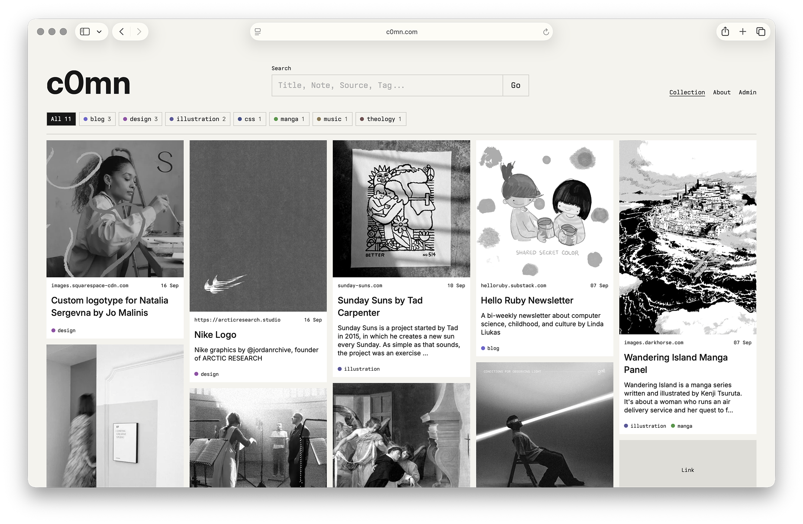

# c0mn.com
> Commonplace Rails app for collecting and sharing ideas

c0mn turns URLs into a visual collection of inspiration from around the web. Save a link, add tags or notes, and c0mn organizes it into a browsable archive while preserving the original source. Instead of creating new content, you collect and connect what already matters to you.



## How It Works

1. **Capture:** Save a URL to an image, article, video, song, tool, or anything else worth returning to.
2. **Context:** Let c0mn infer its source and media type, then add tags and Markdown notes.
3. **Connect:** Search and filter a visual archive where relationships emerge across sources and subjects.

## Features

- URL-first collection
- Automatic source and media-type inference
- Tags with colored visual markers
- Markdown notes
- Masonry-style collection browsing
- Search and tag filtering
- Private administrator access

## Tech Stack

| Layer | Technology |
| --- | --- |
| Application | Ruby / Rails |
| Assets | Propshaft / Vanilla CSS |
| Data | SQLite / Solid Cache / Solid Queue / Solid Cable |
| Deployment | Docker / Kamal |
| Hosting | Hetzner Cloud / AMD64 |

## Development

```sh
bundle install
bin/rails db:prepare
bin/rails server
```

## Admin

```sh
OWNER_EMAIL="you@example.com" \
OWNER_USERNAME="admin" \
bin/rails owner:bootstrap
```

The command prompts for a password. Sign in at `/login`.

## Tests

```sh
bin/rails test
bin/rails test:system
bin/rubocop
```

## Deployment

```sh
bin/kamal deploy
bin/kamal logs
bin/kamal console
```

## Images

Image URLs are saved locally as still WebP copies, capped at 500 KB for detail pages, 100 KB for cards, and 25 KB for thumbnails. Failed imports can be retried from the admin.

Backfill existing images in production:

```sh
bin/kamal app exec --reuse "bin/rails images:backfill"
```

Back up the `c0mn_storage` volume, which contains the database and images.
